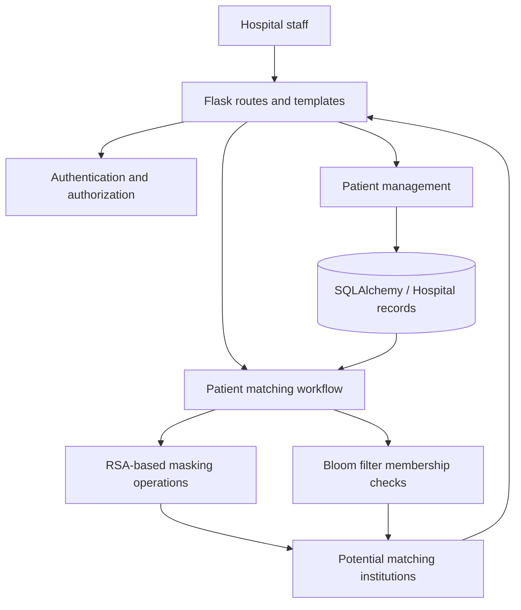

<div align="center">

# HealthShare

### Privacy-Preserving Patient Matching Across Hospitals

**An academic prototype exploring how healthcare institutions can identify shared patient records without exchanging their complete patient datasets.**

Built with **Python, Flask, RSA-based cryptographic operations, and a custom Private Set Intersection–inspired workflow**.

[Watch the Demo](https://www.youtube.com/watch?v=ARDW8PGq74k) · [Explore the Source Code](https://github.com/biancabojescu/Licenta-PSI-App)

</div>

---

## The Problem

Hospitals may need to determine whether a patient has previously been registered at another institution. Comparing patient records directly, however, can require sharing sensitive identifiers and medical information that the receiving institution does not need.

**HealthShare explores a narrower question:** can an institution identify a potential patient match at another hospital while limiting what is disclosed about that hospital's records?

The application demonstrates this idea through a web-based patient management workflow and a custom, RSA-based matching algorithm inspired by **Private Set Intersection (PSI)**. Rather than displaying another hospital's patient record, a successful search identifies the institution where a corresponding identifier appears to exist.

> **Academic prototype:** HealthShare demonstrates cryptographic concepts and application design. It is **not** a formally verified PSI protocol, a production-ready healthcare platform, or a substitute for a security and privacy audit. Use synthetic data only.

## Demo

**[Watch the HealthShare walkthrough on YouTube](https://www.youtube.com/watch?v=ARDW8PGq74k)**

The demonstration introduces the application workflow and the cross-hospital patient matching concept.

## What You Can Do

- **Manage patients:** create, update, and search for patient records through a Flask web interface.
- **Manage access:** register, confirm an email address, log in, and use role-specific application functionality.
- **Associate records with hospitals:** store patient information with an institutional context.
- **Protect selected fields at rest:** encrypt sensitive patient fields before saving them to the database.
- **Search across institutions:** look for potential matches to a patient identifier in other hospital datasets.
- **Limit displayed results:** show matching institutions rather than another hospital's complete patient information.
- **Perform administrative tasks:** access user-management functionality through an administrator dashboard.

## What Makes It Technically Interesting

### 1. A custom PSI-inspired matching workflow

The central feature is an implementation of a **set-matching workflow inspired by RSA-based Private Set Intersection**. It combines modular arithmetic, randomized masking, and membership checks to explore whether a patient identifier appears in another institution's records.

At a high level:

1. A hospital user searches for a patient using a **CNP** (Romanian national identification number).
2. The application processes the identifier and compares it against records associated with other hospitals.
3. The matching routine applies RSA-based masking and unmasking operations.
4. A **Bloom filter** helps test membership in the candidate set.
5. The interface reports institutions with potential matching records rather than displaying their full patient datasets.

The orchestration and cryptographic helpers are organized in `app/protocol_psi.py` and `app/psi/`.

**Important distinction:** the repository uses its own PSI-inspired construction, not a standardized or independently audited PSI implementation. In the current architecture, the application server also performs private-key operations and has access to decrypted data during processing. Consequently, the prototype does not provide the same privacy guarantees as a formally analyzed, distributed PSI protocol.

### 2. RSA cryptography and modular arithmetic

The project uses **PyCryptodome** to generate and manage RSA key material. Application-level encryption is applied to selected patient fields, including patient identifiers, before database storage.

The matching mechanism also uses RSA-related arithmetic to transform and compare identifiers. This offers a practical example of how mathematical cryptographic operations can be integrated into a web application rather than treated as an isolated algorithm exercise.

The encryption implementation is custom and should not be interpreted as a production-approved encryption scheme. In particular, direct textbook-style RSA arithmetic is not a substitute for a properly designed and reviewed encryption protocol.

### 3. Bloom filters for set membership

A custom Bloom filter supports membership testing in the matching process. Bloom filters are useful because they represent a set compactly, but they come with a trade-off: **false positives are possible**.

Accordingly, HealthShare should be understood as identifying *potential* matches, not as delivering a cryptographic proof that two patient records are identical.

### 4. A complete Flask application around the algorithm

The cryptographic routine is integrated into a larger application rather than presented only as a command-line proof of concept. The repository contains:

- Flask routes and Jinja2 templates for hospital-facing workflows;
- authentication and email-confirmation functionality;
- SQLAlchemy models for institutions, users, and patients;
- patient management forms and validation;
- database migrations with Flask-Migrate/Alembic;
- hospital-specific patient tables supporting the matching demonstration.

This makes the project an exploration of **cryptographic logic, persistence, authentication, and end-to-end application design**.

## Technology Stack

| Area | Technologies |
| --- | --- |
| Language | Python |
| Web application | Flask, Jinja2 |
| Data layer | SQLAlchemy, Flask-SQLAlchemy, Flask-Migrate, Alembic |
| Database | SQLite by default; configurable SQLAlchemy database URI |
| Forms & authentication | Flask-WTF, WTForms, Werkzeug security utilities, email confirmation helpers |
| Cryptographic operations | PyCryptodome, RSA, custom modular-arithmetic utilities |
| Membership testing | Custom Bloom filter |
| Email & configuration | Flask-Mail, python-dotenv |

## Architecture



### Repository Guide

```text
licenta3/
├── app/
│   ├── psi/                    # Cryptographic and Bloom-filter utilities
│   ├── protocol_psi.py         # Cross-hospital matching workflow
│   ├── models.py               # Database models
│   ├── forms.py                # Form definitions and validation
│   ├── routes.py               # Patient operations and matching routes
│   ├── routes_autentificare.py # Registration, login, email confirmation
│   ├── routes_dashboard.py     # Administrative workflows
│   └── templates/              # Jinja2 pages
├── migrations/                 # Database migrations
├── config.py                   # Application configuration
└── main_psi.py                 # Flask entry point
```

## Getting Started

> These instructions are based on the supplied repository documentation. The repository was reported to have **no pinned `requirements.txt`**, so dependency installation may require adjustments. The commands below have not been independently executed as part of this README rewrite.

### Prerequisites

- Git
- Python 3.12 (the documented development environment used Python 3.12.5)
- A Python virtual environment (`venv`)
- Database access if you configure PostgreSQL instead of the default SQLite setup
- SMTP credentials or a test mailbox if you want to exercise email confirmation

### 1. Clone the repository

```bash
git clone https://github.com/biancabojescu/Licenta-PSI-App.git
cd Licenta-PSI-App/licenta3
```

### 2. Create a virtual environment

**macOS / Linux**

```bash
python3 -m venv .venv
source .venv/bin/activate
```

**Windows (PowerShell)**

```powershell
python -m venv .venv
.\.venv\Scripts\Activate.ps1
```

### 3. Install the Python dependencies

The supplied project documentation reports that a pinned dependency manifest is not included. The following command reflects the dependencies and versions documented for the development environment:

```bash
python -m pip install Flask==3.0.3 Flask-Mail==0.10.0 Flask-Migrate==4.0.7 Flask-SQLAlchemy==3.1.1 Flask-WTF==1.2.1 WTForms==3.1.2 email_validator==2.1.1 python-dotenv==1.0.1 pycryptodome==3.20.0 SQLAlchemy==2.0.30 alembic==1.13.1 psycopg2-binary==2.9.9
```

For easier reproducibility, a future improvement is to add and maintain a tested `requirements.txt` or equivalent dependency lockfile.

### 4. Configure the application

The project documentation references `licenta3/.env.example`. If that file is present, copy it to `.env` and supply local values:

```bash
cp .env.example .env
```

PowerShell:

```powershell
Copy-Item .env.example .env
```

A typical configuration may include the following variables; **confirm their names against `config.py` and the example file** before use:

```dotenv
DATABASE_URL=sqlite:///app.db
SECRET_KEY=replace-with-a-random-secret
SECURITY_PASSWORD_SALT=replace-with-a-random-salt
MAIL_SERVER=smtp.example.com
MAIL_PORT=587
MAIL_USE_TLS=True
MAIL_USERNAME=your-test-account@example.com
MAIL_PASSWORD=replace-with-test-credentials
MAIL_DEFAULT_SENDER=your-test-account@example.com
```

Never commit `.env`, database files containing patient information, or generated private keys.

### 5. Apply database migrations

From `licenta3/`, with your environment activated:

```bash
flask db upgrade
```

If Flask cannot locate the application automatically, inspect the entry point and Flask app factory settings to configure the required `FLASK_APP` value.

### 6. Start the application

```bash
python main_psi.py
```

Open the local address printed by Flask in your terminal. The documented entry point enables debug mode, so **run this application only in a local development environment**.

## Example Workflow

Use **fictional patient records only**:

1. Register a hospital user and complete email confirmation.
2. Sign in and create synthetic patient entries linked to different institutions.
3. Include the same fictional identifier in two hospital datasets.
4. Open the patient intersection/search interface and enter that identifier.
5. Review the institutions reported as potential matches.

The intended outcome is to show **which other institution may have a matching patient**, without exposing the rest of that institution's patient record in the search results.

## Security Model & Limitations

HealthShare is a **research and learning prototype**, not software intended for actual patient data or deployment in a clinical environment.

| Area | Current limitation |
| --- | --- |
| Cryptographic protocol | Custom PSI-inspired logic; no formal privacy or security proof |
| Trust boundary | One application environment handles private-key operations and decryption |
| Encryption | Custom RSA arithmetic is not a reviewed production encryption design |
| Membership results | Bloom filters can produce false-positive matches |
| Data architecture | Dynamically created per-hospital tables complicate long-term maintainability |
| Quality assurance | The supplied documentation reports no automated test suite |
| Compliance | No verified regulatory certification or compliance assessment |

Do not use real patient information with this prototype. Protect environment configuration and RSA private-key material, and avoid making security, GDPR, or clinical-safety guarantees based on the demonstration alone.

## Testing

The supplied repository documentation does not identify automated unit or integration tests. To evaluate the project today, follow the **Example Workflow** with synthetic records and verify both positive and negative matching scenarios.

Suggested future tests include:

- identical identifiers across two institutions;
- distinct identifiers that should not match;
- Bloom-filter false-positive behavior;
- invalid or malformed encrypted values;
- authentication and role-based access checks;
- database and email-flow integration tests.

These are **test recommendations**, not claims about existing coverage.

## Future Improvements

- [ ] Adopt a standardized, independently reviewed PSI protocol.
- [ ] Separate institutional trust boundaries and improve key management.
- [ ] Replace custom encryption patterns with appropriately designed, reviewed primitives.
- [ ] Add automated tests for matching, authentication, and application workflows.
- [ ] Rework the database schema to avoid dynamically creating hospital-specific tables.
- [ ] Add a documented threat model and evaluate privacy assumptions.
- [ ] Improve dependency management, developer setup, and production-hardening guidance.

## Academic Context

HealthShare was developed as a **bachelor's thesis project**, exploring how privacy-oriented algorithms can be translated into an application workflow for healthcare institutions. Its purpose is to demonstrate and study an approach to cross-hospital record matching—not to claim production-level cryptographic security.

## License

The supplied repository documentation does not identify a license file. Unless a license has since been added, **no open-source license has been granted**. Add an explicit license if you intend to permit others to reuse, modify, or distribute the code.

---

<div align="center">

**HealthShare** · Academic project · Python · Flask · Cryptography · Privacy-Preserving Matching

[Source Code](https://github.com/biancabojescu/Licenta-PSI-App) · [Video Demo](https://www.youtube.com/watch?v=ARDW8PGq74k)

</div>
